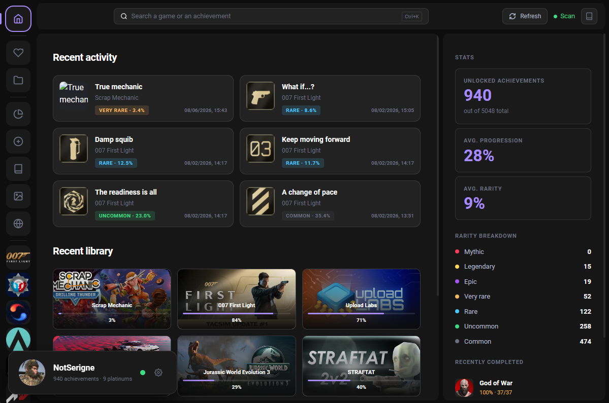
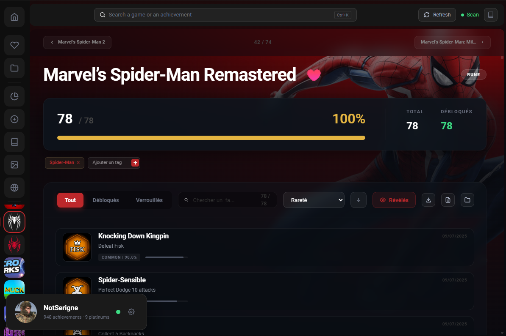
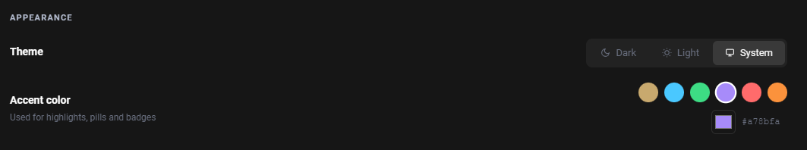
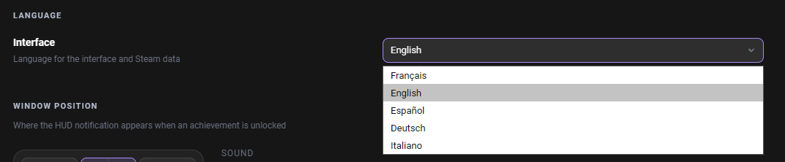

<div align="center">
  

  # Accolade

  **Give your achievements a second life.**

  [](https://github.com/NotSerigne/Accolade/releases/latest)
  [](https://github.com/NotSerigne/Accolade/releases)
  [](LICENSE)
  [](https://tauri.app/)
  [](https://svelte.dev/)
  [](https://www.rust-lang.org/)

  _A Windows desktop app that tracks, enriches, and displays your achievements from emulated, cracked, and legitimate games — with real-time overlay notifications, live in-game HUD, playtime tracking, and a modern customizable UI._

  [Download](#-download) • [What's New in v1.2](#-whats-new-in-v12) • [Features](#-features) • [Supported Sources](#-supported-emulators--sources) • [Setup](#-setup) • [Contributing](#-contributing)

</div>

---

## ⬇️ Download

Head to the [**Releases**](https://github.com/NotSerigne/Accolade/releases/latest) page and grab the `.msi` installer or the `.exe` setup.

> **Requirements**: Windows 10 / 11 (64-bit). WebView2 is usually already installed; if not, Windows will prompt you automatically.

---

## 🚀 What's New in v1.2

- 🕹️ **Live Process & Running Game Detection** — Automatically detects which game you are currently playing (both legitimate Steam installs and emulated/cracked games via `steam_appid.txt` + `steam_api(64).dll`, `OnlineFix.ini`, `steam_emu.ini`, `ColdClientLoader.ini`, `cream_api.ini`, `SmartSteamEmu.ini`, `ALI213.ini`) and displays a live **"Now Playing"** card in the sidebar.
- ⏱️ **Automatic & Manual Playtime Tracker** — Tracks your playtime in real time while a game is running, merges it with Steam playtime, displays your most-played games on the Stats page, and includes an inline manual playtime editor (`Hours` / `Minutes`) per game.
- ⏳ **HowLongToBeat (HLTB) Integration** — Fetches **Main Story**, **Main + Extra**, and **Completionist** durations from HowLongToBeat (with local disk caching and a custom estimate fallback editor) and compares them against your actual playtime with a visual progress bar.
- 📌 **Pinned Achievements & In-Game HUD (`Alt+O`)** — Pin any locked achievement to follow it in the Journal or bring up a transparent, click-through in-game HUD (`Alt+O` global shortcut) showing your pinned targets and closest-to-completion achievements.
- 📈 **Achievement Progress Bars & Milestone Notifications** — Reads intermediate achievement progress (`74/100`) from Goldberg (JSON & binary `stats.bin` paired with `UserGameStatsSchema_*.bin`), TENOKE, ALI213, and SmartSteamEmu, and triggers milestone notifications at **25%, 50%, and 75%**.
- 🎨 **Overlay Skins & Custom Sounds** — Choose between **Accolade**, **Steam**, **PlayStation 5**, **Xbox**, and **Minimal** notification skins, customize scale & duration, or import your own `.mp3`, `.wav`, `.ogg`, and `.m4a` unlock sounds (with separate normal & rare/platinum audio).
- 🎬 **Instant Replay GIFs (`Alt+F10`) & Screenshot Lightbox** — Rolling background screen buffer that saves an animated GIF clip on unlock or via `Alt+F10`, plus a full-screen gallery lightbox with game/achievement metadata and search filters.
- ✏️ **Manual Achievement Editor (with Date & Time)** — Lock or unlock any achievement directly from its card and pick a custom unlock date & time; changes are persisted in Accolade and written back to your local emulator files (`JSON`, `INI`, `TXT`).
- 🏆 **Gamerscore (XP), Profile Level & Activity Heatmap** — Dynamic XP points based on Steam global rarity (up to **200 XP** for Mythic `< 0.1%` + **250 XP** Platinum bonus), profile level progression bar in the sidebar, and a 52-week GitHub-style unlock heatmap on the Stats page.
- 💾 **One-Click Full Backup & Restore (`.zip`)** — Export and restore your entire Accolade configuration, custom sounds, caches, and all local emulator achievement folders in a single `.zip` archive.
- ⚡ **Smart Steam & SteamGridDB Sync Engine** — Built-in sync mutex, rate-limited `appdetails` requests with exponential backoff on HTTP `403`/`429`, persistent disk caching (`steam_appdetails_cache.json`), and automatic **SteamGridDB Plan B** name resolution.

---

## ✨ Features

### 🔔 In-Game Overlay & HUD
- **Real-time unlock notifications** — Instant overlay popup the moment an achievement unlocks or crosses a progress milestone (**25% / 50% / 75%**), no Alt-Tab needed.
- **5 Visual Skins** — **Accolade** (Gold), **Steam**, **PlayStation 5**, **Xbox**, and **Minimal**, with configurable screen position, display duration, and scale (`75%` to `135%`).
- **Custom Audio** — Built-in sound presets (*Default*, *PlayStation*, *Xbox*, *Steam*, *Retro*) plus custom `.mp3` / `.wav` / `.ogg` / `.m4a` import for both standard and rare/platinum unlocks.
- **In-Game Achievement Tracker HUD (`Alt+O`)** — Toggle an on-screen transparent tracker at the top-left of your screen showing your pinned achievements for the running game.

### 📊 Library, Stats & Progression
- **Rich Steam & SteamGridDB Metadata** — Pulls localized achievement names, descriptions, icons, global completion percentages, genres, and high-res icons from Steam and SteamGridDB (with automatic fallback if Steam rate-limits requests).
- **Playtime & HowLongToBeat** — Automatic background session timer, manual playtime override, and HLTB completion bars (**Main Story**, **Main + Extra**, **100% Completionist**).
- **Gamerscore & Analytics** — XP & Level system in the sidebar, 52-week activity heatmap, rarity breakdown (*Mythic*, *Legendary*, *Epic*, *Very Rare*, *Rare*, *Uncommon*, *Common*), and Top 5 rarest unlocked achievements.
- **Journal & Pinned Goals** — Chronological timeline of unlocked achievements, personal objectives, and a dedicated **Pinned Achievements** section with one-click unpinning.
- **Manual Achievement Manager** — Toggle any achievement's unlocked state and edit its exact unlock timestamp directly from the game page.

### 📸 Media & Sharing
- **Auto Screenshots & `Alt+F9` Hotkey** — Automatically captures the screen on unlock (or manually via `Alt+F9`) and links each screenshot to its game and achievement in a full-screen lightbox gallery.
- **Instant Replay GIF (`Alt+F10`)** — Captures the last seconds of gameplay as an animated `.gif` when an achievement pops or on demand.
- **Friend Comparison (Drag & Drop)** — Export your profile to `.json` or `.pdf` and drag & drop a friend's `.json` profile onto the **Compare** page to inspect head-to-head stats and per-game completion.
- **Full `.zip` Backup & Restore** — Safeguard all your emulator save/achievement files and Accolade data in one click from Settings.

---

## 📸 Screenshots

<p align="center">
  
</p>

<table>
<tr>
<td></td>
<td></td>
</tr>
</table>

<details>
<summary>More screenshots</summary>



</details>

---

## 🕹️ Supported Emulators & Sources

Accolade automatically scans default directories as well as any custom folders you add in Settings:

| Source / Emulator | Default Location / Format |
| :--- | :--- |
| **Steam** | Official Steam library, family-shared games & local `userdata` |
| **Goldberg / GSE** | `%APPDATA%\Goldberg SteamEmu Saves` or `%APPDATA%\GSE Saves` (`achievements.json` + binary `stats.bin`) |
| **CODEX** | `%PUBLIC%\Documents\Steam\CODEX` or `%APPDATA%\Steam\CODEX` (`achievements.ini`) |
| **RUNE** | `%PUBLIC%\Documents\Steam\RUNE` or `%APPDATA%\Steam\RUNE` (`achievements.ini`) |
| **OnlineFix** | `%PUBLIC%\Documents\OnlineFix` (`achievements.ini` / `Stats.ini`) |
| **Empress** | `%APPDATA%\Empress` or `%PUBLIC%\Documents\Empress` (`achievements.json`) |
| **TENOKE** | Game folder `SteamData\user_stats.ini` & `%APPDATA%\TENOKE` |
| **FLT (FairLight)** | `%APPDATA%\FLT` (`achievements.ini` / `achievements.txt`) |
| **SmartSteamEmu (SSE)** | `%APPDATA%\SmartSteamEmu` (`achievements.ini` / `stats.bin`) |
| **ALI213 / Valve** | `Profile\Stats\Achievements.Bin` / `.ini` & `%APPDATA%\ALI213` |
| **CreamAPI** | `%APPDATA%\CreamAPI` (`achievements.ini` / `achievements.json`) |
| **RetroAchievements** | Retro console achievements synced via your RetroAchievements username & Web API Key |

---

## ⚙️ Setup

On first launch, a setup wizard will guide you through the configuration. You can also update these anytime in **Settings**:

| Setting | Required | How to get it |
| :--- | :---: | :--- |
| **Steam ID** (64-bit) | ✅ | [steamid.io](https://steamid.io) or your Steam profile URL |
| **Steam API Key** | ✅ | [steamcommunity.com/dev/apikey](https://steamcommunity.com/dev/apikey) |
| **SteamGridDB API Key** | ⬜ | [steamgriddb.com/profile/preferences/api](https://www.steamgriddb.com/profile/preferences/api) — HD icons & automatic fallback game names |
| **RetroAchievements API Key** | ⬜ | [retroachievements.org/settings](https://retroachievements.org/settings) — optional retro console sync |

### ⌨️ Default Global Shortcuts
- **`Alt+O`** — Toggle the In-Game Achievement Tracker HUD
- **`Alt+F9`** — Capture a manual screenshot
- **`Alt+F10`** — Save an Instant Replay GIF clip (when Instant Replay is enabled in Settings)

---

## 🛠️ Build from source

You'll need [Node.js 20+](https://nodejs.org/), [Rust](https://www.rust-lang.org/tools/install) and the [Tauri v2 prerequisites](https://tauri.app/start/prerequisites/).

```bash
git clone https://github.com/NotSerigne/Accolade.git
cd Accolade
npm install

# Development (hot-reload)
npm run tauri dev

# Type-check & unit tests
npm run check
cargo test --manifest-path src-tauri/Cargo.toml --lib

# Release build (installer output in src-tauri/target/release/bundle/)
npm run tauri build
```

---

## 🤝 Contributing

Contributions are welcome! To report a bug or suggest a feature, open an [Issue](https://github.com/NotSerigne/Accolade/issues/new/choose) using the appropriate template.

To submit code:

1. Fork the project
2. Create a branch (`git checkout -b feature/my-feature`)
3. Commit your changes
4. Open a Pull Request

> 🇫🇷 The developer is French — feel free to open issues or discussions in French too.

---

## 📔 Legal

⚠️ The software offered here is solely for informational purposes and does not facilitate or promote unauthorized access to copyrighted content.

Use of the software given here is at your own risk. There is no explicit or implicit warranty; this is offered just as is.
The authors and firm disclaim all liability for any harm that may occur to you or your computer as a result of installing or using the free software and its accompanying documentation on this website.
And for anything that might happen as a result of using or not being able to use the resources on this website.

No cracking scene groups are connected to or involved with the software offered here.

Software provided here is not affiliated nor associated with Steam, © Valve Corporation, Uplay, © Ubisoft and data from their API is provided as is without any express or implied warranty.

The software offered here is not connected to Steam or copyright Valve Corporation, and information from their API is given without any kind of explicit or implicit guaranty.

Copyright and other trademarks belong to their respective owners. The use of third-party resources is not meant to violate any copyright or trademark. The materials of this project are protected by copyright, unless otherwise noted.

---

## 📄 License

Distributed under the [MIT License](LICENSE). © 2025–2026 NotSerigne.

---

<div align="center">
  <sub>Accolade is not affiliated with Valve, Steam, or any game publisher.</sub>
</div>
